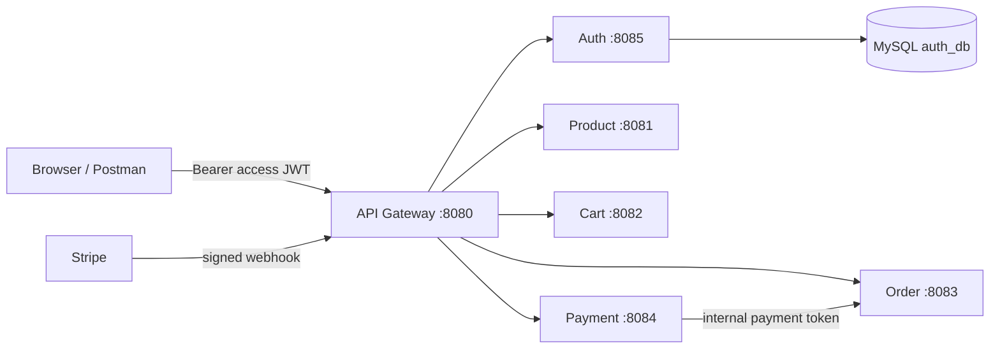
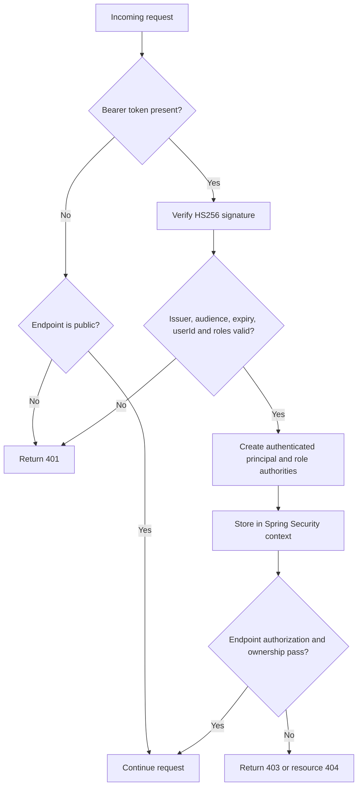

# RoviQue Authentication and Payments

## Architecture



The Auth service creates HS256 JWTs. The Gateway uses Spring Security's reactive `AuthenticationWebFilter`; the MVC Auth, Product, Cart, Order, and Payment services use `OncePerRequestFilter`. All validate the signature, issuer, audience, and expiration with the same environment-provided key. The Auth service additionally loads the user through `UserDetailsService` and uses the database's current ID and role as the authorities. No OAuth2 Resource Server, OIDC, or JWKS endpoint is used.

The JWT signing key is shared by all six applications. This is a trusted internal-service secret: keep service ports private and expose only the Gateway. The Gateway removes client-supplied identity and internal-payment headers; downstream services must not be directly reachable from untrusted networks.

## Authentication and JWT flows

```mermaid
sequenceDiagram
    participant C as Client
    participant G as Gateway
    participant A as Auth
    participant DB as Auth MySQL
    C->>G: POST /api/v1/auth/login (email, password)
    G->>A: Route login request
    A->>DB: UserDetailsService loads user by email
    A->>A: AuthenticationManager checks BCrypt password
    A->>A: Sign short-lived HS256 JWT
    A-->>C: Access JWT in JSON; refresh token in HttpOnly cookie
    C->>G: Protected request with Authorization: Bearer JWT
    G->>G: Verify signature/claims; create authenticated principal
    G->>Product: Forward request
    Product->>Product: OncePerRequestFilter validates JWT and sets SecurityContext
```

JWT validation at the Gateway and MVC services follows this decision flow:



JWT claims are `iss`, `sub` (email), `aud`, `iat`, `exp`, `userId`, and `roles`. Roles in Spring Security are granted as `ROLE_USER` or `ROLE_ADMIN`. The signing/validation key is Base64-encoded and must decode to at least 32 bytes (256 bits). Generate a key once and configure the **same value** on every service; never commit it:

```powershell
$bytes = New-Object byte[] 32
[Security.Cryptography.RandomNumberGenerator]::Fill($bytes)
[Convert]::ToBase64String($bytes)
```

Set the returned value as `AUTH_JWT_SECRET` in each IntelliJ run configuration. `AUTH_JWT_ISSUER` defaults to `http://localhost:8085`, `AUTH_JWT_AUDIENCE` to `rovique-api`, and `AUTH_JWT_ACCESS_TOKEN_TTL` to `PT15M`.

The refresh token is 32 cryptographically random bytes, returned only as an `HttpOnly` cookie, stored in MySQL only as a SHA-256 hash, and rotated on refresh. Reuse of a revoked token revokes that user's active refresh tokens. The default cookie is `Secure`, `SameSite=Strict`, scoped to `/api/v1/auth`; for local plain-HTTP testing set `AUTH_REFRESH_COOKIE_SECURE=false`.

## Auth project structure and dependencies

`E:\RoviQue\auth\src\main\java\com\auth` contains:

| Package | Responsibility |
|---|---|
| `controller` | Register, login, refresh, logout, and current-user HTTP APIs |
| `service` | Authentication, JWT creation, and refresh-token rotation/revocation |
| `entity` / `repository` | MySQL user, role, and refresh-token persistence |
| `dto` | Validated request, success, and error models |
| `security` | `AuthPrincipal` and the JWT `OncePerRequestFilter` |
| `config` | `SecurityFilterChain`, BCrypt, CORS, key, and stateless configuration |
| `exception` | Consistent validation and authentication error responses |

Auth and the protected services use Spring Security and JJWT `0.12.6`; the four MVC services and Gateway no longer depend on the OAuth2 Resource Server starter. Project versions remain Java 21, Spring Boot 4.1.2, and Spring Cloud 2025.1.4.

The JWT libraries added to each application are `io.jsonwebtoken:jjwt-api:0.12.6`, plus runtime `jjwt-impl:0.12.6` and `jjwt-jackson:0.12.6`. Auth uses Spring Security's `AuthenticationManager` with a `DaoAuthenticationProvider`, `UserDetailsService`, and BCrypt `PasswordEncoder`; MVC services use `SecurityFilterChain` plus `OncePerRequestFilter`. Gateway uses its reactive Spring Security chain and authentication filter.

## Configuration

Required environment variables:

| Variable | Used by | Purpose |
|---|---|---|
| `AUTH_JWT_SECRET` | Auth, Gateway, Product, Cart, Order, Payment | Shared Base64 HS256 key (minimum 32 decoded bytes) |
| `AUTH_DB_USERNAME`, `AUTH_DB_PASSWORD` | Auth | Auth MySQL credentials |
| `AUTH_DB_URL` | Auth | Optional; defaults to local `auth_db` |
| `CART_DB_USERNAME`, `CART_DB_PASSWORD` | Cart | Cart MySQL credentials |
| `CART_DB_URL` | Cart | Optional; defaults to local `cart_db` |
| `ORDER_DB_USERNAME`, `ORDER_DB_PASSWORD` | Order | Order MySQL credentials |
| `ORDER_DB_URL` | Order | Optional; defaults to local `order_db` |
| `PAYMENT_DB_USERNAME`, `PAYMENT_DB_PASSWORD` | Payment | Payment MySQL credentials |
| `PAYMENT_DB_URL` | Payment | Optional; defaults to local `payment_db` |
| `PRODUCT_DB_USERNAME`, `PRODUCT_DB_PASSWORD` | Product | Product MySQL credentials |
| `PRODUCT_DB_URL` | Product | Optional; defaults to local `product_db` |
| `AUTH_JWT_ISSUER`, `AUTH_JWT_AUDIENCE` | All JWT validators | Must match across applications |
| `AUTH_JWT_ACCESS_TOKEN_TTL` | Auth | Access-token lifetime; default 15 minutes |
| `AUTH_REFRESH_TOKEN_TTL` | Auth | Refresh-token lifetime; default 30 days |
| `AUTH_REFRESH_COOKIE_SECURE` | Auth | Use `false` only for local HTTP |
| `INTERNAL_PAYMENT_TOKEN` | Order and Payment | Private service token for internal order reads and payment-status writes |
| `STRIPE_SECRET_KEY` | Payment | Stripe API credential |
| `STRIPE_WEBHOOK_SECRET` | Payment | Secret for verifying `Stripe-Signature` |
| `STRIPE_PUBLISHABLE_KEY` | Payment | Optional publishable key |
| `AWS_S3_BUCKET`, `AWS_REGION` | Product | S3 bucket and region; region defaults to `eu-north-1` |
| `AWS_ACCESS_KEY_ID`, `AWS_SECRET_ACCESS_KEY` | Product (optional) | Local AWS SDK credentials only; prefer an AWS CLI profile or workload role |

Set these values in each service's run configuration for local development.
For production, store passwords, signing keys, and payment credentials in a
secret manager such as AWS Secrets Manager and inject them into the service as
environment variables at startup. Do not copy secret values into this
document, source control, container images, or logs. See the repository-level
`SECRETS.md` for setup and rotation guidance.

Auth's principal properties are `auth.jwt.secret=${AUTH_JWT_SECRET}`, `auth.jwt.issuer`, and `auth.jwt.access-token-ttl`. Gateway and downstream services use the corresponding `security.jwt.*` properties. Auth JPA creates/updates the schema by default; configure `AUTH_JPA_DDL_AUTO` appropriately for deployment.

The relevant property shape is:

```properties
# Auth
auth.jwt.secret=${AUTH_JWT_SECRET}
auth.jwt.issuer=${AUTH_JWT_ISSUER:http://localhost:8085}
auth.jwt.access-token-ttl=${AUTH_JWT_ACCESS_TOKEN_TTL:PT15M}

# Gateway, Product, Cart, Order, and Payment
security.jwt.secret=${AUTH_JWT_SECRET}
security.jwt.issuer=${AUTH_JWT_ISSUER:http://localhost:8085}
security.jwt.audience=${AUTH_JWT_AUDIENCE:rovique-api}
```

## Database schema

Auth manages two tables:

```text
users
  id            BIGINT primary key, generated
  name          VARCHAR(100), not null
  email         VARCHAR(254), unique, not null
  password      VARCHAR(100), BCrypt hash, not null
  role          VARCHAR(16), USER or ADMIN, not null (registration always USER)
  created_at    DATETIME, not null
  updated_at    DATETIME, not null

refresh_tokens
  id                    BIGINT primary key, generated
  token_hash            CHAR(64), unique SHA-256 hex digest
  user_id               BIGINT foreign key to users.id
  created_at            TIMESTAMP, not null
  expires_at            TIMESTAMP, not null
  revoked_at            TIMESTAMP, nullable
  replaced_by_token_hash CHAR(64), nullable
```

The `Role` enum contains only `USER` and `ADMIN`. Public registration does not accept a role field. Promote a local test user using a trusted database administrator, then log in again to obtain an ADMIN token; do not expose a role-update API.

## API reference

Use the Gateway base URL `http://localhost:8080`.

| Method and path | Access | Behavior |
|---|---|---|
| `POST /api/v1/auth/register` | Public | Create a USER; `name`, `email`, and `password` are required (password 8–72 characters) |
| `POST /api/v1/auth/login` | Public | Authenticate with `AuthenticationManager`; returns access token and sets refresh cookie |
| `POST /api/v1/auth/refresh` | Refresh cookie | Rotates refresh cookie and returns a new access token |
| `POST /api/v1/auth/logout` | Refresh cookie | Revokes the refresh token and clears the cookie |
| `GET /api/v1/auth/me` | Authenticated | Return the current database user |
| `GET /api/v1/product/**` | Public | Product, category, brand, and price browsing |
| `POST`, `PUT`, `DELETE /api/v1/product/{products,categories,brands}/**` | ADMIN | Catalog management |
| `POST /api/v1/cart/add` | Authenticated | Add item; owner comes from JWT, price is not trusted from the client |
| `GET /api/v1/cart/{uuid}` | Authenticated owner | Read own cart |
| `DELETE /api/v1/cart/{uuid}/items` | Authenticated owner | Clear own cart |
| `POST /api/v1/order/all` | Authenticated | Create order from owned cart (`X-CART-ID`) |
| `GET /api/v1/order/{id}` | Authenticated owner or ADMIN | Read order |
| `POST /api/v1/payment/checkout` | Authenticated owner | Create Stripe Checkout for an existing owned order |
| `GET /api/v1/payment/orders/{id}/status` | Authenticated owner | Check Stripe and return payment status |
| `POST /api/v1/payment/webhook` | Public URL, Stripe signature required | Verify and process Stripe PaymentIntent events |

Catalog mutation authorization is also enforced in the Product service, not just at the Gateway. Cart and Order derive user IDs from verified JWTs and return `404` for another user's resource. The Payment service checks order ownership before checkout/status requests. Internal `GET /api/v1/internal/orders/{id}` and payment-status updates require `X-Internal-Service-Token`; configure `INTERNAL_PAYMENT_TOKEN` identically in Order and Payment. The Gateway strips that header from client requests.

Login response shape:

```json
{
  "accessToken": "<JWT>",
  "tokenType": "Bearer",
  "expiresIn": 900,
  "user": {
    "id": 7,
    "name": "Example User",
    "email": "user@example.com",
    "role": "USER",
    "createdAt": "2026-01-01T10:00:00"
  }
}
```

No password or refresh token is included in JSON. Auth API errors use an object containing `timestamp`, `status`, `error`, `message`, `path`, and optional field errors. Duplicate email returns `409`; invalid login/refresh returns `401`; validation errors return `400`.

## Stripe webhook

Configure Stripe to send these events to `https://<public-host>/api/v1/payment/webhook`:

* `payment_intent.succeeded` → `PAID`
* `payment_intent.payment_failed` → `REQUIRES_PAYMENT_METHOD`
* `payment_intent.canceled` → `CANCELED`

Other signed event types are acknowledged as ignored. The handler verifies the raw body with Stripe's `Webhook.constructEvent` and `STRIPE_WEBHOOK_SECRET`, then requires the PaymentIntent's `metadata.orderId`, checks the order through the protected internal Order endpoint, and compares amount, currency, and item totals to the saved order before updating status. Paid/canceled states cannot regress to a non-paid status. Do not mark an order paid based on a browser redirect or client-supplied amount/status.

For local development, set `STRIPE_WEBHOOK_SECRET` to the signing secret printed by Stripe CLI and forward events to `http://localhost:8080/api/v1/payment/webhook`. The webhook is unauthenticated by JWT intentionally; its Stripe signature is mandatory.

## Postman verification

Create Postman environment values `baseUrl=http://localhost:8080` and `accessToken`. For authenticated requests set `Authorization: Bearer {{accessToken}}`; set `Content-Type: application/json` for JSON bodies. Postman should retain the `ROVIQUE_REFRESH_TOKEN` cookie from login.

1. **Register:** `POST {{baseUrl}}/api/v1/auth/register`, body `{"name":"User A","email":"a@example.com","password":"correct-horse-1"}`. Expect `201`, role `USER`, and no password.
2. **Duplicate email:** repeat the same registration. Expect `409`.
3. **Valid login:** `POST {{baseUrl}}/api/v1/auth/login`, body `{"email":"a@example.com","password":"correct-horse-1"}`. Expect `200`, `accessToken`, and an HttpOnly refresh cookie. Save `accessToken`.
4. **Invalid login:** same endpoint with a wrong password. Expect generic `401`; response must not reveal whether the email exists.
5. **No JWT:** call `GET {{baseUrl}}/api/v1/cart/<known-cart-uuid>` without Authorization. Expect `401`.
6. **Valid JWT:** call `GET {{baseUrl}}/api/v1/auth/me` with the token. Expect `200` and User A's safe profile.
7. **Expired JWT:** temporarily configure Auth `AUTH_JWT_ACCESS_TOKEN_TTL=PT1S`, restart, log in, wait two seconds, then call `/api/v1/auth/me`. Expect `401`.
8. **Modified JWT:** change one character in the saved token's final signature segment and call `/api/v1/auth/me`. Expect `401`.
9. **USER on ADMIN API:** as User A, send `POST {{baseUrl}}/api/v1/product/categories` with body `{"name":"Postman category"}`. Expect `403`.
10. **ADMIN on ADMIN API:** promote a local test user to ADMIN in MySQL, log in again, then send the same request. Expect `201` (or a catalog validation response if the name conflicts), not `403`.
11. **User A reads User B's cart:** register/login User B, create a cart with `POST {{baseUrl}}/api/v1/cart/add` and body `{"productId":1,"brandId":1,"quantity":1}`; retain response `X-CART-ID`. As User A call `GET {{baseUrl}}/api/v1/cart/{{userBCartId}}`. Expect `404`.
12. **User A reads User B's order:** User B creates an order with `POST {{baseUrl}}/api/v1/order/all` and header `X-CART-ID: {{userBCartId}}`. As User A call `GET {{baseUrl}}/api/v1/order/{{userBOrderId}}`. Expect `404`.
13. **Unauthorized payment status:** call `GET {{baseUrl}}/api/v1/payment/orders/{{userBOrderId}}/status` without a JWT. Expect `401`; as User A expect `404` for User B's order.
14. **Stripe signature:** create a Postman environment value `stripeWebhookSecret` equal to Payment's `STRIPE_WEBHOOK_SECRET`. Send `POST {{baseUrl}}/api/v1/payment/webhook`, with no Authorization header and raw JSON body:

    ```json
    {
      "id": "evt_postman_test",
      "object": "event",
      "api_version": "2024-06-20",
      "created": 1760000000,
      "data": {
        "object": {
          "id": "pi_postman_test",
          "object": "payment_intent",
          "amount": 1234,
          "currency": "usd",
          "metadata": { "orderId": "17" },
          "status": "succeeded"
        }
      },
      "livemode": false,
      "pending_webhooks": 1,
      "type": "payment_intent.succeeded"
    }
    ```

    Use an existing order `17` whose saved amount is `$12.34`; update `orderId` and `amount` to match another order as needed. Add this Postman pre-request script to sign the exact raw body (or send real events using Stripe CLI):

    ```javascript
    const timestamp = Math.floor(Date.now() / 1000);
    const payload = pm.variables.replaceIn(pm.request.body.raw);
    const digest = CryptoJS.HmacSHA256(
      `${timestamp}.${payload}`,
      pm.environment.get("stripeWebhookSecret")
    ).toString(CryptoJS.enc.Hex);
    pm.request.headers.upsert({
      key: "Stripe-Signature",
      value: `t=${timestamp},v1=${digest}`
    });
    ```

    Expect `200` with `{"status":"processed",...}` and the order payment state changed to `PAID`. Alter the payload after signing or remove/change `Stripe-Signature`; expect `400` and no state change. Stripe CLI is preferred for end-to-end testing against Stripe's actual webhook signing secret.

Refresh/logout checks: `POST {{baseUrl}}/api/v1/auth/refresh` with the retained cookie should rotate it; reusing the old cookie should return `401` and revoke active refresh sessions. `POST {{baseUrl}}/api/v1/auth/logout` clears/revokes the current refresh cookie.
